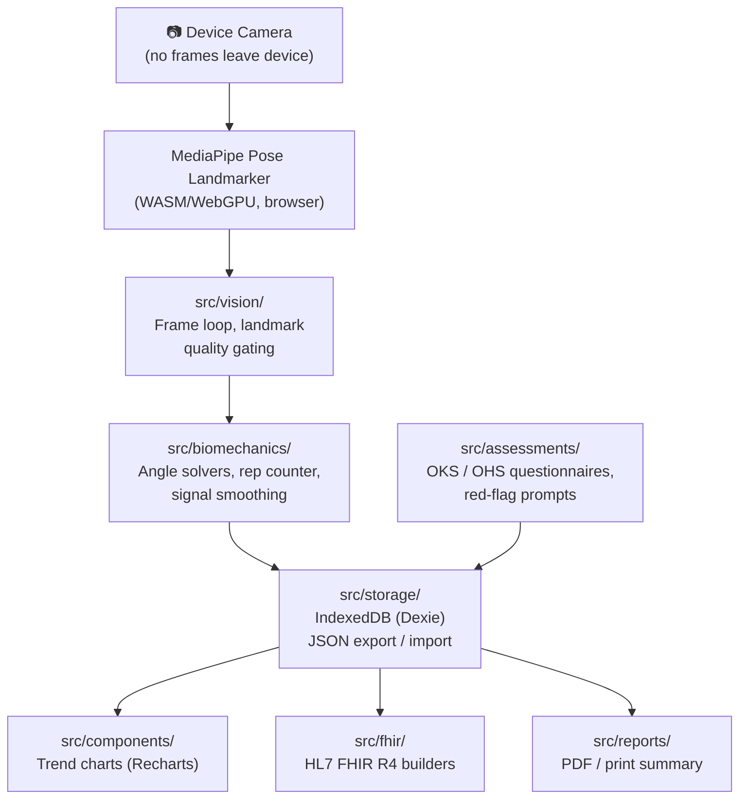

# JointTrack

**Privacy-first, edge-computed physiotherapy and functional mobility tracking for adults 60+ in Ireland.**

> ⚠️ **JointTrack is not a medical diagnostic tool.** It records objective movement measurements and self-reported questionnaires to support — not replace — conversations with your GP, physiotherapist, or orthopaedic specialist. If you experience sudden severe pain, inability to bear weight, joint locking/catching, fever, or rapid swelling, seek medical attention immediately.

---

## Problem Context

In 2024 the HSE removed GP-referred hip and knee MRIs from the Community Diagnostics Scheme for adults, leaving many people aged 60+ waiting months for physiotherapy or orthopaedic specialist review with no objective record of how their condition is changing over time.

JointTrack fills this documentation gap. It runs entirely in the browser — no data leaves the device — and generates a clear longitudinal summary a GP, physio, or consultant can review in under two minutes.

---

## Features (Milestone Roadmap)

| Day | Milestone | Status |
|-----|-----------|--------|
| 1 | Repo scaffold, biomechanics math module + 50+ unit tests | ✅ Complete |
| 2 | Oxford Knee/Hip Score (OKS/OHS) questionnaires + scoring tests | 🔜 |
| 3 | MediaPipe Pose camera integration + angle overlay | 🔜 |
| 4 | IndexedDB persistence (Dexie) + JSON export | 🔜 |
| 5 | Longitudinal trend charts (Recharts) | 🔜 |
| 6 | HL7 FHIR R4 export + PDF clinician summary | 🔜 |
| 7+ | Accessibility polish, red-flag prompts, edge-case hardening | 🔜 |

---

## Privacy by Design

- **100% client-side processing.** MediaPipe Pose Landmarker runs locally via WebAssembly/WebGPU. Raw camera frames are never uploaded or stored.
- **Local-only storage.** All session data is stored in the browser's IndexedDB. Users can export, import, or delete everything at any time.
- **No tracking, no analytics, no server.** JointTrack is a static web app — it can be self-hosted from a USB stick.
- **Non-diagnostic scope.** Outputs are framed as objective measurements and questionnaire responses, keeping the application within low-risk wellness/documentation software (outside EU MDR Article 2(1) clinical device scope).

---

## Architecture



### Module responsibilities

| Module | Purpose |
|--------|---------|
| `src/biomechanics/` | Pure TypeScript functions: 3D joint angle solvers, Savitzky-Golay smoothing, 5×STS rep counter. No browser dependencies — 100% unit-testable. |
| `src/vision/` | MediaPipe initialisation, `requestAnimationFrame` camera loop, landmark confidence gating. |
| `src/assessments/` | Oxford Knee/Hip Score question definitions, scoring (0–48), delta tracking, and red-flag symptom prompt logic. |
| `src/storage/` | Dexie (IndexedDB) schema, session repositories, full JSON backup/restore, and "Delete All Data" utility. |
| `src/fhir/` | Typed HL7 FHIR R4 builders for `Observation` (ROM measurements) and `QuestionnaireResponse` (OKS/OHS) bundles. |
| `src/reports/` | jsPDF-based one-page clinician summary with baseline vs. latest ROM, PROM trend, and red-flag checklist. |
| `src/components/` | Reusable accessible UI: large touch targets (≥44px), high-contrast colour palette, 18px minimum body text. |

---

## Tech Stack

| Layer | Technology |
|-------|-----------|
| Framework | React 19 + TypeScript 5 |
| Build | Vite 8 |
| Styling | Tailwind CSS v4 |
| Computer Vision | `@mediapipe/tasks-vision` (Pose Landmarker, WASM) |
| Charts | Recharts |
| Local DB | Dexie (IndexedDB wrapper) |
| PDF export | jsPDF |
| Testing | Vitest + @testing-library/react |
| Linting | oxlint + @typescript-eslint |
| CI | GitHub Actions |

---

## Local Setup

```bash
# 1. Clone
git clone https://github.com/kattran177/jointtrack.git
cd jointtrack

# 2. Install dependencies
npm install

# 3. Start development server
npm run dev
# → http://localhost:5173

# 4. Run unit tests
npm test

# 5. Run tests with coverage
npm run test:coverage

# 6. Type-check
npm run typecheck

# 7. Production build
npm run build
```

The app runs entirely in the browser — there is no backend server to configure.

---

## Camera Permission Note

The ROM tracking feature uses `getUserMedia` to access the device camera. The browser will prompt for permission. No video is transmitted or stored; frames are processed in memory by MediaPipe and immediately discarded.

For best results use a laptop or tablet in landscape orientation, positioned 1.5–2 m from the subject at mid-body height.

---

## Adapting for Clinical or Research Pilots

JointTrack is designed to be easy to fork and adapt:

- **Custom PROM questionnaires** — add question definitions in `src/assessments/` following the OKS/OHS pattern.
- **Additional joint tracking** — add new angle-solver functions in `src/biomechanics/angles.ts`; they are automatically tested.
- **Institutional branding** — update colours in `src/index.css` and the header in `src/App.tsx`.
- **FHIR endpoint push** — the `src/fhir/` module produces valid FHIR R4 bundles; add a thin `fetch` call to POST to your FHIR server (requires appropriate consent flow).

---

## Regulatory Scope

JointTrack is wellness and documentation software. It does **not**:
- Generate or suggest diagnoses
- Recommend treatment
- Replace clinical assessment
- Make triage decisions

It is designed to remain outside the scope of the EU Medical Device Regulation (MDR 2017/745) by limiting its function to objective measurement recording and questionnaire administration — equivalent to a paper goniometer log.

See [DISCLAIMER.md](./DISCLAIMER.md) for the full safety and scope statement.

---

## Contributing

Pull requests are welcome. Please:
1. Write Vitest unit tests for any new biomechanics or scoring logic.
2. Keep browser-API dependencies out of `src/biomechanics/` and `src/assessments/`.
3. Follow the existing TypeScript strict-mode conventions.

---

## Licence

MIT — see [LICENSE](./LICENSE).
